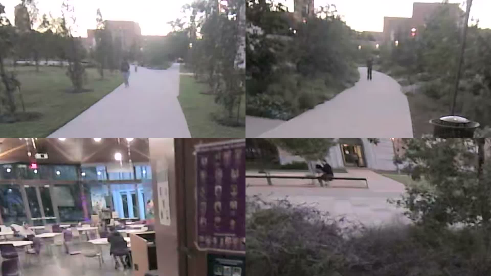

# VLM eval, test-1: first results

2026-11-16 · clip `test-1` · model `gemini-3.5-flash` · judge `gemini-3.1-flash-lite`

## Summary

- **The model sees almost every labeled person.** It said "someone is here" on 92 of 94 frames where the labels have people (recall 0.98), and it caught every one of the 13 stretches where people are in view.
- **Precision reads 0.75, but that is mostly a labeling gap, not the model.** Of the 30 frames scored as false alarms, the 4 we checked by eye all show real people who aren't in `humans.csv`: people seated in the cafeteria, someone on a bench, and walkers seen a few seconds before their labeled appear time. Precision and the hallucination score will stay understated until those frames are reviewed.
- **Rubric score: 79 of 85 covered points** (93%). The 5 question checks were all answered correctly, which also means they're too easy to tell models apart. Distance estimation (15 points) has no checks yet.
- **Object recall is 0.84** (123 of 147 annotated objects named). Most misses are small or generic things: shrubs, curbs, planters, doors.
- This run was made on the Gemini free tier (20 requests per model per day), so frames were sent 25 per request. Results with one frame per request may differ slightly.

## What was tested

| | |
|---|---|
| Clip | `data/test-1/test-1.mp4`: 5:00, 30 fps, 3840×1080 side-by-side stereo. Hat file `19166522959_20260907_121843_00005.mp4` (segment 5 of that session). A walk from a cafeteria across a campus at dusk. |
| View shown to the model | Left eye (1920×1080), the same view the people labels were made on |
| People ground truth | `data/test-1/humans.csv`: 32 people with appear and leave times, from YOLOv8s + ByteTrack tracks checked by eye (method in `data/test-1/humans.md`) |
| Rubric ground truth | `data/test-1/rubric.md`: objects listed every 10 s (30 timestamps), 5 question checks, 6 weighted categories |
| Model under test | `gemini-3.5-flash` (Google served it as `gemini-3.6-flash`) |
| Judge | `gemini-3.1-flash-lite`, text only. It compares answers with the ground truth; it doesn't see the frames. |
| Requests | 21: 12 for people (300 frames, 25 per request), 7 for the rubric, 2 for grading. Free tier, so no cost. |

## People

One frame per second, 300 frames. A frame is scored only when the labels are certain about it: 28 frames were skipped because only people marked "intermittent" or hidden were in view, and 14 because someone appeared or left within 0.25 s.

| Metric | Value |
|---|---|
| Recall: frames with people where it said yes | **0.98** (92 / 94) |
| Precision: "yes" answers on labeled frames | **0.75** (92 / 122), understated, see below |
| F1 | 0.85 |
| False alarm rate: "yes" on frames labeled empty | 0.18 (30 / 164), overstated, see below |
| People count exactly right (80 frames with people) | 0.71 |
| People count within one | 1.00 (it overcounts slightly: mean +0.16) |
| Stretches with people where it said yes at least once | 13 / 13 |
| People seen on frames where they were alone in view | 9 / 9 |

**Misses (2):** 1:36 (the runner, human18, while still far away) and 2:36 (human23, a small figure at the far end of the arcade). Both are small, distant figures, and look like real misses.

### The labels miss some people



*Zoomed from frames the eval scored as false alarms. Top left 2:55: someone walking toward the camera, 3 s before human24's labeled appear time. Top right 3:45: someone on the path, 3 s before human26. Bottom left 0:18: two people seated in the cafeteria, 7 s after the last labeled diner leaves. Bottom right 4:16: someone sitting on a bench.*

The 30 frames scored as false alarms fall into these stretches. Only the four marked ✓ have been checked by eye.

| When | Frames | What the model reported | Likely explanation |
|---|---|---|---|
| 0:18 ✓ | 1 | person at a table in the back | Seated diners still in view after the labeled ones leave |
| 0:26–0:27 | 2 | person at a table; someone outside through the glass door | Same, plus a person outside |
| 0:31 | 1 | someone walking under the covered area | Unlabeled background person? |
| 1:06 | 1 | someone walking beside the camera on the right | human14 leaves at 1:05.75; a leg may still be in frame |
| 1:20 | 1 | two people far away by the street | Unlabeled distant people? |
| 1:28 | 1 | someone far ahead and someone at the bottom-right edge | human15 leaves at 1:27.75 and may still be at the edge |
| 1:40, 1:44–1:45 | 3 | two people far down the path | Probably human19 and human20, before their 1:46.75 appear time |
| 2:53–2:57 ✓ | 5 | someone far down the walkway | human24 seen before the labeled 2:58 |
| 3:04 | 1 | someone far down the path, and someone by the arches | human25 seen before the labeled 3:04.50, plus a person by the building? |
| 3:15–3:16 | 2 | someone near the building arches | Unlabeled person by the building? |
| 3:32–3:47 ✓ | 9 | someone far down the path | human26 (labeled from 3:48, "distant speck"; the README says its appear time is approximate) |
| 4:16 ✓ | 1 | someone on a bench | Seated person, not in the labels |
| 4:28–4:29 | 2 | two people far away by the building | human28 and human29, whose appear times the labels call approximate |

**What to do:** add the missing people to `humans.csv` (or move the appear times earlier), then rerun with `--score-only`. That recomputes every number from the saved answers, with no API calls.

## Rubric scorecard

Each category is the plain average of its evidence (each item scored 0–1), times its weight.

| Category | Weight | Score | Points | Evidence |
|---|---|---|---|---|
| Object identification | 25 | 0.92 | 23.0 | object recall 0.84; Eval 1 = 1.00 |
| Person detection and counting | 15 | 0.85 | 12.8 | people F1 0.85; exact count 0.71; Eval 2 = 1.00 |
| Spatial reasoning | 20 | 1.00 | 20.0 | Eval 3 = 1.00; Eval 5 = 1.00 |
| Temporal reasoning | 15 | 1.00 | 15.0 | Eval 4 = 1.00 |
| Distance estimation | 15 | – | – | no checks yet |
| Uncertainty and hallucination | 10 | 0.82 | 8.2 | 1 − people false alarm rate (understated, see above) |
| **Total** | **100** | | **79.0 / 85** | 85 of 100 points have evidence |

### Question checks: 5 / 5

| Eval | Time | Question | Ground truth | Model's answer |
|---|---|---|---|---|
| 1 | 0:30 | Vehicle near the right edge? | Bicycle | bicycle |
| 2 | 1:50 | Pedestrians approaching? | Two, possibly a third behind | 2 |
| 3 | 1:00 | Which side is the parked vehicle on? | Right | on the right side |
| 4 | 1:00–1:10 | Handheld device that appears? | Smartphone | smartphone |
| 5 | 2:30 | Objects near the building? | Two dark trash bins, bike racks | bike racks, trash cans, and a recycling bin |

### Objects: recall 0.84

The model listed what it saw at each of the 30 timestamps, and the judge checked which annotated objects were on its list. The weakest timestamps were 2:40, 3:40 and 4:20 (2 of 5 each). The most-missed objects were shrubs (4 times), then doors, curb, planter and grass (twice each). The annotations list only the main objects in each frame, so extra objects in the model's list aren't penalized. That means this score shows what the model notices, not whether it makes things up.

## Caveats

- **One model, one clip.** A `gemini-3-flash-preview` run started but hit its daily free quota partway. Its partial results are on disk but not in this report.
- **Batching:** 25 frames went in each request to fit the free tier. Each request mixes frames from across the whole clip, about 12 s apart, so the model can't follow a person between them, but answers may still differ from one frame per request.
- **The judge is lenient by design.** It accepts a general name for the same object ("building" for "arched building"), and it's the lite model, because the Pro models have no free quota. All of its grades were read by hand: they follow that rule, with no clear mistakes.
- **The question checks are easy.** At 5 / 5 they can't separate models. Harder questions would help: counting groups, things that are partly hidden, and order of events.
- **Distance estimation** can't be scored until the stereo pair is calibrated.

## Reproduce

```sh
python3 eval/vlm_eval.py test-1 --model gemini-3.5-flash --batch 25
python3 eval/rubric_eval.py test-1 --model gemini-3.5-flash --judge gemini-3.1-flash-lite --batch 15
```

The key goes in `.env.local` as `GEMINI_KEY=...`. Answers are cached under `eval/out/test-1/`, so rerunning only fills in what's missing, and a used-up daily quota stops the run cleanly. Full per-frame and per-object detail:

- `eval/out/test-1/people/gemini-3.5-flash-left-every30f-batch25/report.md`
- `eval/out/test-1/rubric/gemini-3.5-flash-left/report.md`

## Next steps

1. Review the 30 disputed frames, update `humans.csv`, and rescore with `--score-only`.
2. Run `gemini-3-flash-preview` once its quota resets, to compare a second model.
3. Add harder question checks and, once the cameras are calibrated, distance checks.
4. With a paid key, rerun at one frame per request (`--batch 1`) with a Pro judge, to see how much batching and the lite judge change the numbers.
